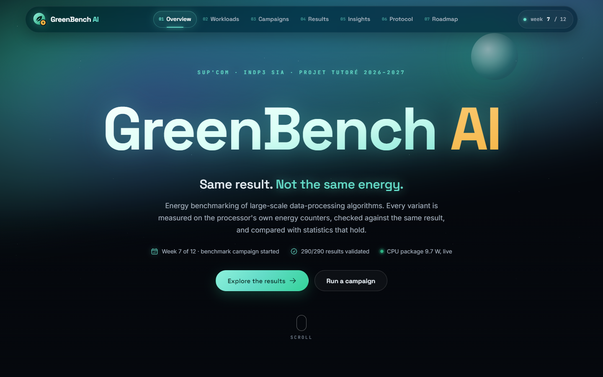
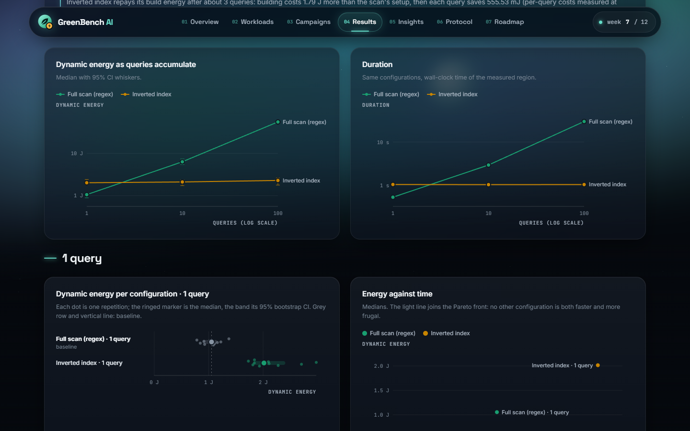

# GreenBench AI

**Same result. Not the same energy.**

GreenBench measures how much energy different implementations of the *same* data-processing task consume. It runs every variant under a controlled protocol, reads the processor's hardware energy counters, checks that each variant returns exactly the same result, and turns the measurements into recommendations of the form *"X cuts energy by N % for a Y % latency cost"*, with confidence intervals and effect sizes.

Tutored project, SUP'COM INDP3 SIA, 2026–2027 · Bajar Omar & Khlif Bilel · supervised by Mohamed Ayadi & Nejib Boubaker (SUP'COM) and Soumaya Bouchemi (AIVRA / GET Wireless).

**Live dashboard: [bilelkhlif.github.io/greenbench](https://bilelkhlif.github.io/greenbench/)** (a read-only snapshot of the committed results; run it locally to measure).



## Status: week 7 of 12

| Weeks | Phase | Deliverable | Status |
|---|---|---|---|
| 1–3 | State of the art | [State-of-the-art report](docs/01-state-of-the-art.md) | ✅ delivered |
| 4–6 | Measurement protocol | [Documented & automated protocol](docs/02-measurement-protocol.md) + this tool | ✅ delivered |
| 7–9 | Benchmark campaign | [Week-7 campaign report](docs/03-week-7-campaign-report.md) · [raw results](results/) | 🟡 pilot campaign done |
| 10–12 | Packaging & defense | Tool & docs, recommendations report, final report | upcoming |

## First evidence (week-7 pilot campaign)

29 configurations × 10 repetitions after 2 warm-ups, 348 isolated runs, all 290 measured results validated against the reference, on an AMD Ryzen 7 6800HS laptop under Windows 11. Energy is the CPU-package energy above idle, measured by the RAPL counters.

| Study | Finding |
|---|---|
| Storage format | **Parquet + Snappy uses 56 % less energy than CSV** (95 % CI 46–59 %) and runs 55 % faster; JSON lines costs 3.6× CSV. |
| Text search | An **inverted index repays its build energy after ~3 queries**; at 100 queries it uses 96 % less energy than a regex scan (2.3 J vs 55.7 J). |
| Streaming windows | **Incremental panes cut energy by 80 %**, exactly. HyperLogLog used 2.7× more than that; a 10 % sample saved nothing extra and erred by 15 %. |
| Indexing | A **B+-tree cuts energy by 81 %** at 1,000 queries and repays its build after ~150 queries; a hash index costs 6.9× the B+-tree once range queries appear. |
| Joins × threads | **Fastest is not greenest**: every multi-threaded join used 28–44 % more energy than the single-threaded hash join, even when it was faster. |
| Meter cross-check | A CPU-time × TDP software model tracks RAPL (Pearson r = 0.996) but **reverses 4 of 45 significant verdicts, all about thread counts**. |



## Quick start

Requirements: Python 3.10+ (3.11 used for the campaign). Node.js 20+ is only needed to rebuild the dashboard.

```powershell
# Windows (PowerShell)
git clone https://github.com/bilelkhlif/greenbench.git
cd greenbench
python -m venv .venv
.venv\Scripts\activate
pip install -e ".[dev]"
greenbench env            # machine fingerprint and available energy meters
greenbench meter          # live CPU-package power for 5 s
greenbench serve          # dashboard on http://127.0.0.1:8000
```

```bash
# Linux / macOS
python3 -m venv .venv && source .venv/bin/activate
pip install -e ".[dev]"
greenbench serve
```

The repository already contains the week-7 campaign, so the dashboard shows results immediately. To measure your own machine:

```bash
greenbench run --preset quick       # small data, 5 repetitions, a few minutes
greenbench run --preset standard    # the week-7 protocol, about 20 minutes on a laptop
greenbench report latest            # Markdown report in results/<campaign>/report.md
```

Campaigns can also be launched and followed from the dashboard (*Campaigns* page). Datasets are generated on first use from a fixed seed (about 0.5 GB for the medium scale, kept in `workspace/`, not in Git).

## How it measures

* **Energy meters.** On Windows, GreenBench reads the RAPL package and per-core counters that Windows publishes through its *Energy Meter Interface*. No driver and no administrator rights are needed, and the counters refresh on every read (~8 µs). On Linux it reads `powercap` RAPL counters. A software model (TDP share × CPU time + DRAM heuristic) is recorded next to every measurement to cross-check it.
* **Protocol.** One fresh process per run; inputs, imports and the meter are prepared outside the measured region; 2 warm-ups discarded; 10 rounds, each in a new random order; idle power measured before, during and after the campaign and subtracted; background load and virtualisation recorded; every result checksummed against a reference.
* **Statistics.** Medians with bootstrap 95 % confidence intervals, ratios of medians, two-sided Mann–Whitney U tests with Holm correction, Cliff's δ effect sizes, Pareto fronts, and break-even query counts for indexes.

Details: [measurement protocol](docs/02-measurement-protocol.md).

## Workloads

| Workload | Variants | Knobs |
|---|---|---|
| Large-volume join (orders ⋈ customers → revenue per country) | hash join, sort-merge join | threads 1–8, 7 storage formats |
| Text search (keyword AND queries over tickets) | regex full scan, inverted index | 1–100 queries |
| Streaming aggregation (5-min windows sliding every minute) | batch recompute, incremental panes, HyperLogLog, 10 % sample | storage |
| Indexing (point + range lookups) | full scan, B+-tree, hash index | 1,000–100,000 queries |

Every exact variant must reproduce the reference checksum or the run is discarded; approximate variants are scored on their relative error.

## Repository layout

```
src/greenbench/
  meters/       Windows EMI and Linux RAPL readers, software energy model
  data/         seeded multi-source dataset generator, storage formats (CSV, JSON, Parquet × codecs)
  workloads/    the four tasks and their variants
  protocol/     study plans, isolated worker, campaign runner, reference results
  analysis/     statistics, recommendations, Markdown report
  server/       FastAPI backend + built dashboard (static/)
web/            dashboard source (React + Vite + Motion): dark "aurora" theme, animated page transitions
docs/           deliverables: state of the art, protocol, week-7 report
results/        campaign outputs: campaign.json, runs.jsonl, analysis.json, report.md
tests/          pytest suite (variant equivalence, data structures, statistics, meters, API)
```

## Development

```bash
pytest                          # 46 tests, ~25 s
cd web && npm install && npm run build   # rebuilds src/greenbench/server/static
npm run dev                     # dashboard with hot reload on :5173 (API proxied to :8000)
```

The dashboard pauses its decorative animations, its live meter and its analysis while a campaign runs, so the page does not add load to the machine being measured. It also honours the system "reduce motion" setting.

### Hosting the dashboard on GitHub Pages

GitHub Pages serves static files only, so the hosted dashboard is a snapshot: the same pages, reading JSON exports of the API built from `results/`. Live power readings and campaign launches stay with the local server.

```bash
cd web
npm install
npm run deploy:pages    # build for /<repo>/, export the data, force-push the gh-pages branch
```

The script derives the site address from the `origin` remote, writes `web/dist-pages/` (`npm run build:pages` stops there), adds a `404.html` so deep links open the app, and publishes with your git identity. One-time setup on GitHub: *Settings → Pages → Build and deployment → Deploy from a branch → `gh-pages` / `(root)`*. Run it again after committing a new campaign to refresh the site.

On Linux the Docker image pins the environment: `docker build -t greenbench .`, then `docker run --privileged -v /sys/class/powercap:/sys/class/powercap:ro greenbench run --preset standard`. Inside a VM or under Docker Desktop no RAPL counter is visible; GreenBench then falls back to the software model and says so.

## Limitations

One reference machine so far; package energy only (no DRAM or storage domain on this laptop); AMD's RAPL values come from an on-chip power model, so relative differences are more trustworthy than absolute joules. Weeks 8–9 add a Linux/Intel machine and 30-repetition campaigns.

## License

[MIT](LICENSE) © 2026 Bajar Omar, Khlif Bilel.
